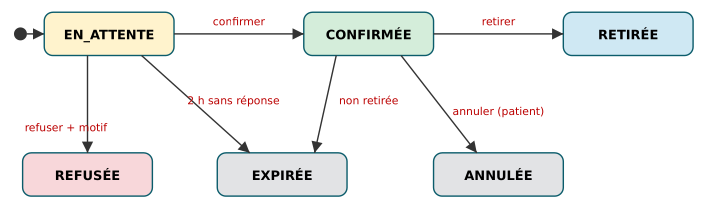
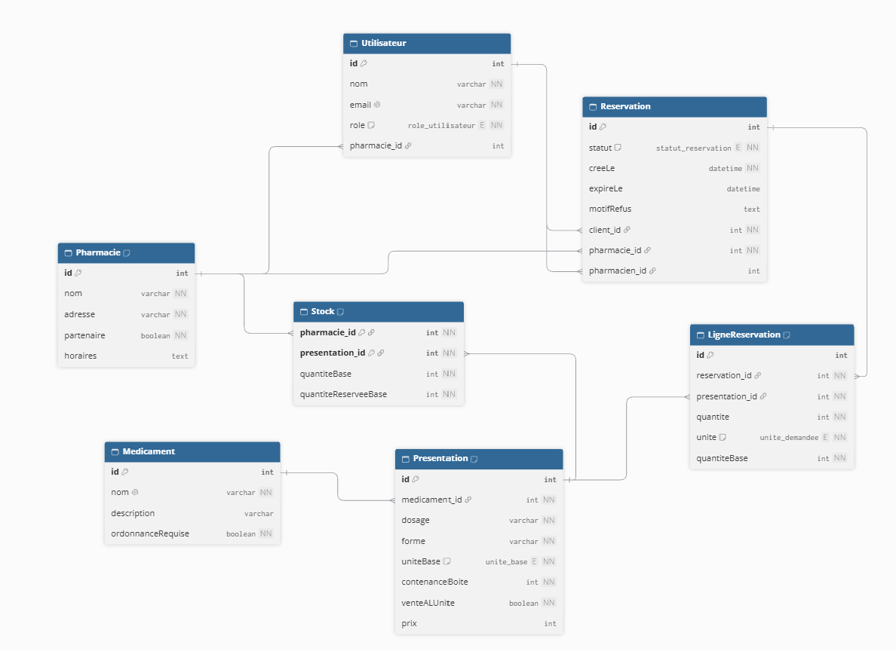

# TP LebonMédoc

## Présentation
LebonMédoc est une plateforme permettant aux utilisateurs de rechercher des médicaments disponibles dans des pharmacies partenaires et de demander leur réservation avant de venir les récupérer.

Les pharmacies peuvent gérer leurs disponibilités, accepter ou refuser les demandes et suivre les réservations en cours.

L'objectif de cet atelier est de concevoir puis de réaliser le cœur fonctionnel de cette plateforme, en accordant une attention particulière aux règles métier, aux responsabilités des différents composants et à la cohérence des données.

Le service ne réalise ni diagnostic, ni prescription, ni délivrance automatique de médicaments. La délivrance demeure sous la responsabilité du pharmacien.

## Objectif
Analyser le fonctionnement de LebonMédoc afin d'identifier les acteurs, le vocabulaire commun, les concepts principaux et les règles métier. Proposer une première modélisation de l'application avant toute réalisation technique.

## Travail attendu
- Identifier les acteurs et leurs principales actions.
- Construire un glossaire des termes métier.
- Identifier les principales entités, leurs propriétés et leurs relations.
- Formaliser les règles métier essentielles : disponibilité, réservation, confirmation, refus et expiration.
- Représenter les états possibles d'une réservation et les transitions autorisées.
- Produire un premier modèle du domaine, sous forme de diagramme de classes simplifié ou équivalent.

## Analyse du domaine

### Acteurs
- **Les pharmacies** : traiter les demandes de réservation, gérer la disponibilité des médicaments.
- **Les clients** : rechercher un médicament en fonction de sa disponibilité dans les différentes pharmacies et demander une réservation.
- **Admin** : référencement et gestion des pharmacies (peut gérer le catalogue des médicaments s'il n'y a pas de formulaire pour les pharmacies).
- **Pharmacien** : trier et préparer les commandes des clients par nombre de médicaments (boîte / comprimé) demandé.

### Glossaire
| Terme | Définition |
|---|---|
| Médicament | Produit du catalogue. |
| Ordonnance | Approbation du médecin pour la consommation de tel médicament pour un traitement. |
| Pharmacies partenaires | Pharmacies ayant rejoint la plateforme. |
| Pharmacien | Personne qui traite les commandes. |
| Client | Personne qui veut commander. |
| Stock | Quantité de médicaments déclarés par les pharmacies partenaires. |
| Quantité / dosage | Valeur numérique pour les médicaments. |
| Prix | Valeur en centimes du médicament. |
| Disponibilité | Quantité non réservée. |
| Commande | Suite de valeurs (médicaments) avec un seul prix (addition de tous les prix) et un numéro d'identification. |
| Demande de réservation | Requête d'un client pour la réservation d'un ou plusieurs médicaments. |
| Confirmation / refus | Décision du pharmacien sur la demande de réservation. |
| Délai de retenue | Durée durant laquelle un médicament est réservé pour un client. |
| Expiration | Date limite dépassée de la réservation. |
| Retrait | Remise du ou des médicaments par la pharmacie au client. |

### Liens entre les entités
- Une pharmacie détient plusieurs stocks ; un stock est uniquement composé (médicament, pharmacie).
- Une réservation appartient à un client, vise une seule pharmacie et contient au moins un médicament.
- Un pharmacien est rattaché à une pharmacie.

## Règles métier

### Disponibilité
- Disponible = quantité / dosage en stock − quantité / dosage réservée (réservations confirmées non retirées). Jamais négatif.
- Seules les pharmacies partenaires actives sont proposées dans la recherche.
- Un médicament à quantité / dosage disponible 0 est affiché « indisponible » et ne peut pas être demandé.
- Seul le pharmacien de la pharmacie modifie son stock.

### Réservation (demande)
- Le patient doit être connecté ; la demande comporte au moins une ligne, quantité ≥ 1 (plafonnée, ex. 5 par ligne).
- Une demande porte sur une seule pharmacie et sur des quantités disponibles au moment de la demande.
- Une demande en attente ne bloque pas le stock : seule la confirmation le réserve.
- Médicament soumis à ordonnance : la demande est possible, l'ordonnance est contrôlée par le pharmacien au retrait.

### Confirmation
- Réservée au pharmacien de la pharmacie concernée, sur une demande `EN_ATTENTE` uniquement.
- La disponibilité est vérifiée ; si elle est insuffisante, la confirmation est impossible (refus).
- La confirmation réserve les quantités et fixe la date limite de retrait (ex. 24 h).

### Refus
- Réservé au pharmacien, uniquement sur une demande à l'état `EN_ATTENTE`, sachant que le motif est obligatoire. Aucun effet sur le stock.

### Expiration
- C'est la demande (état `EN_ATTENTE`) sans réponse après le délai de traitement défini (ex. 2 h).
- Une réservation confirmée non retirée qui atteint la date limite devient également `EXPIRÉE` ; de ce fait, on libère les quantités.

### Annulation et retrait
- Annulation par le patient / le pharmacien de la commande dans l'état `EN_ATTENTE` ou `CONFIRMÉE` : elle devient `EXPIRÉE` ou `ANNULÉE`, et dans ce cas on doit libérer la quantité que l'on a bloquée dans ces états.
- Au retrait, le pharmacien clôture la commande : le stock du ou des médicaments est soustrait définitivement dans les stocks (`RETIRÉE`).

### États d'une réservation


## Modèle du domaine


## Guide

### Lancer
```
npm start    # API sur http://localhost:3000
```

### Postman
Importer `postman/LeBonMedoc.postman_collection.json` et lancer toute la collection (Collection Runner). La première requête appelle `POST /admin/seed`, qui charge `data/jeu-de-donnees.json`. La collection est rejouable. Définir la variable `baseUrl` à `http://localhost:3000`.
